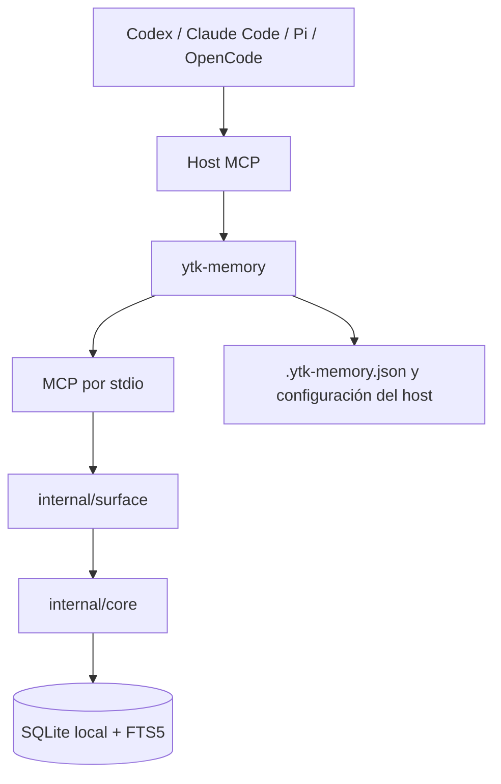

# Arquitectura técnica de Agent Memory

**Revisado:** 2026-10-25

**Runtime:** Go, módulo `native/ytk-memory`
**Audiencia:** ingeniería, SRE, seguridad y mantenedores de integraciones.

Este documento explica qué implementa el código vigente, cómo se conectan sus
componentes, por qué existen y qué límites tienen. Complementa el
[contrato de memoria](agent-memory-contract.md), el [contrato MCP](agent-memory-mcp.md),
el [protocolo de agentes](agent-memory-protocol.md), la [guía de instalación](agent-memory-installation.md)
y los ADR. Si una propuesta histórica difiere del runtime actual, prevalece
[ADR 0009](adr/0009-agent-memory-only-scope.md): este repositorio conserva
memoria operativa de agentes. RAG y conocimiento documental pertenecen a otro
sistema.

## 1. Propósito, objetivos y límites

Agent Memory es una memoria durable local para asistentes de programación. El
agente selecciona conocimiento reutilizable; el binario `ytk-memory` lo valida,
almacena y recupera para un proceso ligado a un solo proyecto.



El diseño local-first elimina la necesidad de red, servicios externos, bases
centrales, embeddings y credenciales de infraestructura. A cambio, la
disponibilidad, permisos, concurrencia, backup y cifrado en reposo dependen del
archivo y del sistema operativo local.

El producto busca: iniciar sesiones con contexto relevante; buscar y leer
memoria dentro del proyecto; guardar hechos curados sin duplicar temas; mantener
revisiones e historial; ofrecer operaciones de mantenimiento; e integrarse con
distintos hosts a través del mismo contrato de dominio.

Fuera del alcance vigente: ingesta automática de repositorios/documentos,
transcripts, RAG, embeddings, búsqueda vectorial/HNSW, PostgreSQL, API HTTP,
sincronización entre dispositivos y telemetría. No asumir que ADR históricos de
ranking híbrido o vector describen funcionalidades desplegadas. No hay cifrado
SQLite a nivel de aplicación; se espera proteger el disco y permisos del host.

## 2. Paquetes, responsabilidades y dependencias

El módulo declara `go 1.27.0` y `github.com/corporate-knowledge/ytk-memory`.

| Paquete | Función | Motivo de la frontera |
| --- | --- | --- |
| `cmd/ytk-memory` | Arranque, flags, resolución de config, comandos, serialización CLI, construcción y lanzamiento MCP. | El dominio no debe conocer argumentos ni comportamiento de hosts. |
| `internal/core` | Entidades, reglas, lifecycle, consultas, transacciones, SQLite/FTS5, conformance y evaluación. | Las reglas se prueban sin iniciar protocolo MCP. |
| `internal/surface` | Schemas/handlers MCP, validación de entradas, aislamiento de proyecto/área/owner y shape de respuestas. | MCP no debe filtrarse a las entidades ni al almacenamiento. |
| `internal/setup` | Setup/uninstall y transformaciones de config de Codex, Claude Code, Pi y OpenCode. | Cada host tiene formato, scope y reglas propios. |
| `internal/release` | Cross-build, archivo, manifiesto, hash, firma y verificación. | El canal de distribución es independiente del ciclo de datos. |

Los paquetes son `internal`: no constituyen API Go pública estable. Las
interfaces externas son MCP, CLI, archivos administrados y formatos de release.

Dependencias principales:

- `modernc.org/sqlite`: driver SQLite puro Go. Evita CGo y dependencias nativas
  del sistema al distribuir binarios autónomos.
- `github.com/modelcontextprotocol/go-sdk`: sesión MCP, registro de tools y
  transporte `stdio`; el proyecto define handlers y policy.
- `github.com/BurntSushi/toml`: parseo del TOML completo de Codex en doctor, no
  sólo extracción textual del bloque administrado.

Las otras dependencias de `go.mod` son transitivas. No se requiere Node,
PostgreSQL ni un runtime de embeddings.

## 3. Modelo de dominio y aislamiento

### 3.1 Proyecto, workspace y área

`.ytk-memory.json` define `project_slug` (también se acepta `projectId`),
`database` y opcionalmente `default_area`. `resolve` busca el archivo desde el
directorio actual hacia arriba y deriva la raíz. Para `project`, el orden es
flag explícito, `YTK_MEMORY_PROJECT_ID`, config local, slug de `remote.origin`
Git y finalmente slug del directorio. Para database y area se usan flag,
variables `YTK_MEMORY_DATABASE`/`YTK_MEMORY_AREA`, config y, para database,
`.ytk-memory/ytk-memory.sqlite` como default. Una ruta relativa es relativa a la
raíz resuelta. `mcp` exige config local para impedir que un arranque accidental
infiera proyecto y base sin setup explícito.

El proceso MCP recibe un `ProjectID` al iniciar y ninguna tool permite cambiar
el workspace de la llamada. Cada lectura del core usa ese workspace; cada
escritura lo obtiene del mismo contexto. Es una frontera deliberada: evita que
el agente solicite datos de otro proyecto alterando argumentos. `workspace_id`
se conserva en filas para asegurar joins/relaciones y reutilizar core en bases
con más de un workspace; no reemplaza el scope del proceso.

El área es una convención de tags (`area:<nombre>`). Surface filtra candidatos
por área después de la consulta y etiqueta en la respuesta una entrada sin área
explícita con el área predeterminada. Es partición lógica de recuperación, no
control criptográfico ni almacenamiento físicamente separado.

### 3.2 Entidades

**Session** registra ID, workspace, owner opcional, fecha de inicio/cierre y
resumen. El transcript no se guarda automáticamente: el agente escribe un
resumen explícito al terminar para reducir ruido, volumen y retención de
conversaciones crudas.

**Memory** registra ID, workspace, sesión origen opcional, tipo, título,
contenido, subject key, tags, estado, fechas de creación/actualización y campos
de vigencia/revisión/archivo.

Tipos aceptados por el core:

- `decision`: elección y motivo, útil para mantener consistencia futura.
- `discovery`: hallazgo o causa raíz, útil para evitar repetir investigación.
- `pattern`: práctica reutilizable o anti-patrón confirmado.
- `preference`: preferencia durable de equipo/proyecto.
- `summary`: síntesis de sesión o consolidación.

Título y contenido son texto libre. Los tipos organizan el conocimiento; tags y
subject keys permiten recuperar y actualizarlo sin imponer un esquema de
documento rígido.

### 3.3 `subjectKey` e idempotencia

Al guardar con subject key, `Save` busca en el workspace la versión `active` de
esa clave vigente al reloj actual. Si existe, actualiza la fila conservando ID
y `created_at`; los campos de expiración/revisión omitidos conservan los valores
anteriores. Sin clave, se crea un registro nuevo. Esto evita copias competidoras
de un mismo tema y permite actualizar una decisión canónica. No existe un
índice UNIQUE: el historial puede contener múltiples filas por clave.

### 3.4 Ciclo de vida y fechas

Estados: `active`, `needs_review`, `superseded`, `archived`. Una fila se puede
recuperar sólo si está activa, `valid_from <= now`, no venció (`expires_at > now`
o NULL), y la fecha de revisión no venció (`review_at > now` o NULL). Una fecha
de revisión vencida excluye el contenido de búsqueda aunque el estado siga
activo; el propósito es que el agente valide antes de reutilizarlo.

Transiciones admitidas por `Transition`:

| Estado actual | Siguientes estados | Razón |
| --- | --- | --- |
| `active` | active, needs_review, superseded, archived | Puede mantenerse, marcarse para revisión o retirarse. |
| `needs_review` | active, needs_review, superseded, archived | Se puede validar/reactivar, mantener pendiente o reemplazar/retirar. |
| `superseded` | superseded, archived | La versión histórica no vuelve a ser canónica. |
| `archived` | archived | Archivo es terminal; se evita reactivar accidentalmente datos retirados. |

`superseded` preserva versiones corregidas; `archived` retira memorias de
recuperación normal. Retención puede borrar físicamente archivadas después de
una fecha umbral. Las fechas se guardan normalizadas a UTC con layout
`2006-01-02T15:04:05.000Z07:00`. `core.Open` acepta un reloj inyectable para
que vencimiento, revisión y tests sean deterministas.

## 4. Core Go

### 4.1 API y ciclo del Store

`core.Open(filename, clock)` configura el reloj, abre `database/sql`, ejecuta
migración y devuelve `*Store`. `Close` cierra el pool. Los métodos reciben
`context.Context`; las operaciones de dominio retornan entidades/resultados o
errores. `SaveInput`, `CompactInput`, `Lifecycle`, `RetentionResult`,
`CorrectionResult`, `ReviewCompletion` son estructuras de frontera interna que
explicitan lo que cada operación necesita.

El core contiene funciones de persistencia reutilizables (`save`, `update`,
`index`) que aceptan un executor compatible con `*sql.DB` o `*sql.Tx`. Esto
permite ejecutar la misma regla de escritura dentro de transacciones mayores y
garantiza rollback conjunto de fila e índice FTS.

### 4.2 Guardado y validación

`Save` abre transacción y aplica, en orden conceptual: campos obligatorios;
validación de contenido sensible; validación de workspace/owner de sesión;
upsert por subject key vigente; normalización/deduplicación de tags; reglas de
tipo, estado y fechas; escritura SQL; actualización de FTS; commit.

Se rechazan patrones comunes: llave privada PEM, JWT compacto de tres partes,
AWS Access Key con prefijo `AKIA`, y asignaciones de `api_key`, `access_token`
o `client_secret` con valores largos. Se inspecciona título y cuerpo antes de
persistir. Es una defensa contra accidentes frecuentes, no un DLP exhaustivo;
los agentes deben omitir secretos aunque pasen el filtro.

`expiresAt` debe ser posterior a `validFrom`; `reviewAt` no puede precederlo.
El tipo/status deben estar en las enumeraciones permitidas. Estas reglas se
centralizan en core para que MCP, CLI y fixtures no diverjan.

### 4.3 Transacciones y consistencia

- Guardar actualiza fila principal y FTS dentro de la misma transacción. Si
  falla indexado, se revierte el save para evitar que búsqueda y lectura
  discrepen.
- Corrección cambia a `superseded`, inserta versión nueva, indexa y crea
  relación `supersedes` dentro de una transacción.
- Compactación inserta resumen, crea relaciones a fuentes y archiva fuentes
  opcionalmente dentro de una transacción.
- Purga borra FTS, relaciones y filas en una transacción para respetar FKs y no
  dejar documentos indexados.

Las claves foráneas SQLite se activan durante cada apertura/conexión migrada.
El pool `database/sql` gestiona conexiones; no hay caché de memoria compartida
entre procesos.

## 5. SQLite: esquema, índices y recuperación

### 5.1 Apertura, WAL y migración

`Open` configura cada conexión mediante el DSN del driver: claves foráneas
activadas, `busy_timeout` de 10 000 ms y transacciones con bloqueo `IMMEDIATE`.
Después activa `PRAGMA journal_mode = WAL` fuera de una transacción. La
activación de WAL reintenta errores SQLite `BUSY`/`LOCKED` hasta seis intentos
con espera exponencial acotada. Luego ejecuta tablas, índices, columnas legacy y
creación/backfill de FTS5 dentro de una sola transacción `IMMEDIATE`; esto
serializa la inicialización entre procesos y evita que dos aperturas observen
simultáneamente una columna o tabla FTS ausente.

WAL permite solapar lectores con un escritor; no permite varios escritores
paralelos. `IMMEDIATE` adquiere el turno de escritura al comenzar la transacción
en vez de después de leer. El timeout deja que otro proceso termine su
transacción antes de informar bloqueo. El código no reejecuta automáticamente
el cuerpo de una escritura ya iniciada: ante un error de `COMMIT` no siempre se
puede inferir desde la aplicación si el resultado se confirmó, y repetir una
operación compuesta podría duplicar efectos. `subjectKey` hace idempotente el
upsert correspondiente, mientras que el timeout y los errores SQLite
accionables manejan contención fuera de ese caso.

La migración actual es idempotente y basada en introspección de columnas. No
hay tabla `schema_migrations` ni se escribe `PRAGMA user_version`; release
declara un `schemaVersion` constante, pero el runtime no mantiene un historial
numerado de migraciones. Por eso `Open` puede mutar DB incluso durante doctor y
upgrade; una apertura no equivale a inspección read-only. Las claves foráneas
quedan activadas para cada conexión mediante el DSN. Las operaciones que
dependen de FKs también verifican ownership/workspace en las reglas de core.

### 5.2 Esquema exacto

#### `sessions`

| Columna | Tipo/Null | Función y razón |
| --- | --- | --- |
| `id` | TEXT PK | Identidad opaca para referencias de sesión. |
| `workspace_id` | TEXT NOT NULL | Aislamiento por proyecto en validaciones. |
| `owner_id` | TEXT NULL | Propietario MCP; nullable por legado/fixtures. Evita cierre cruzado de sesiones. |
| `started_at` | TEXT NOT NULL | Inicio UTC para orden y auditoría. |
| `ended_at` | TEXT NULL | Indica cierre. |
| `summary` | TEXT NULL | Handoff explícito entre sesiones. |

#### `memory_items`

| Columna | Tipo/Null | Función y razón |
| --- | --- | --- |
| `id` | TEXT PK | Identidad estable de la versión. |
| `workspace_id` | TEXT NOT NULL | Scope requerido en cada búsqueda. |
| `session_id` | TEXT NULL, FK sessions | Origen opcional; evita exigir sesión para conocimiento durable. |
| `type` | TEXT NOT NULL | Categoría cerrada para lifecycle/briefing. |
| `title`, `content` | TEXT NOT NULL | Texto legible e indexable. |
| `subject_key` | TEXT NULL | Tema canónico para upsert. |
| `tags_json` | TEXT NOT NULL | Etiquetas flexibles, con orden normalizado y JSON válido. |
| `status` | TEXT NOT NULL | Estado de dominio. |
| `created_at`, `updated_at` | TEXT NOT NULL | Historia temporal y desempate. |
| `valid_from` | TEXT NOT NULL | Permite conocimiento futuro y compatibilidad con default epoch. |
| `expires_at`, `review_at`, `archived_at` | TEXT NULL | Expiración, revisión y archivo opcionales. |

`valid_from` se añadió a legacy con default `1970-01-01T00:00:00.000Z`; las
otras columnas de lifecycle se agregan nullable para que la ausencia conserve
el sentido de “no programado”.

#### `memory_relations`

Columnas `source_memory_id`, `target_memory_id`, `relation`, `created_at`;
clave primaria compuesta por `(source_memory_id, target_memory_id, relation)`;
ambos IDs FK a `memory_items`. El arco es dirigido. Los valores admitidos son
`related`, `supports`, `conflicts_with`, `supersedes`. La PK evita repetir la
misma arista y soporta trazabilidad entre revisiones y fuentes.

#### `memory_items_fts`

Virtual FTS5 con `memory_id UNINDEXED`, `title`, `content`, `tags`,
`subject_key`. El ID no participa en ranking, pero permite unir coincidencias
con la tabla canónica. `index()` borra entrada previa por ID e inserta el texto
actual; tags se unen con espacios. No hay triggers: escrituras SQL manuales
pueden dejar FTS desincronizado y toda herramienta debe pasar por core.

Antes de crear FTS5, la migración consulta `sqlite_master`. Si la tabla falta,
`Open` la crea y rellena desde todas las filas de `memory_items` dentro de una
sola transacción. Cada `tags_json` se decodifica y normaliza al mismo texto que
usa `index()`. Si una fila no puede decodificarse o insertarse, la transacción
revierte: la apertura falla y no deja un índice parcial. Si FTS5 ya existe, la
migración no lo reconstruye para no alterar un índice operativo durante una
apertura rutinaria.

### 5.3 Índices B-tree

| Índice | Columnas | Por qué |
| --- | --- | --- |
| `memory_items_workspace_status_idx` | `(workspace_id,status)` | Consultas recurrentes por scope y estado. |
| `memory_items_subject_key_idx` | `(workspace_id,subject_key)` | Upsert idempotente acotado al workspace. |
| `memory_items_lifecycle_idx` | `(workspace_id,status,valid_from,expires_at,review_at)` | Filtros temporales frecuentes. |
| PK `memory_items` | `(id)` | Get, FTS join, relaciones y corrección. |
| PK `sessions` | `(id)` | Ownership y FK. |
| PK `memory_relations` | `(source,target,relation)` | Deduplicación y consulta por origen. |

Las consultas que parten por destino de relación no tienen índice auxiliar
invertido; el proyecto evita coste de escritura/espacio hasta que un volumen
real justifique esa optimización.

### 5.4 Búsqueda lexical FTS5

`Search` transforma query con `toFTSQuery` y usa `MATCH`. La consulta une FTS a
`memory_items`, filtra workspace, estado activo, `valid_from <= now`, no
expiración y revisión futura/no definida. Ordena por `bm25()` ascendente y
desempata por `updated_at DESC`; aplica limit al final. Esto prioriza
coincidencia textual y actualidad sin modelo externo.

`toFTSQuery` divide por espacios, limpia comillas/paréntesis exteriores,
escapa sintaxis especial y expande un diccionario corto de equivalencias:
autenticación/auth, protección, deployment y rollback. No es stemming general,
traducción ni comprensión semántica. No hay ranking vectorial ni reranker en
el runtime actual, aunque ADR históricos hayan evaluado recuperadores híbridos.

### 5.5 Briefing inicial

`Context` filtra por workspace, `active` y vigencia. Ordena por `priority:critical`,
`priority:high`, summaries, decisiones/preferencias/patrones y luego resto; en
cada grupo, `updated_at DESC`, `id ASC`. Surface solicita candidatos, aplica el
filtro de área y por defecto devuelve máximo 8 entradas/2400 runes. El texto se
recorta para respetar presupuesto total de título+cuerpo. Se cuentan runes
Unicode, no bytes ni tokens del proveedor. Así se controla el tamaño visible,
pero no se estima exactamente el coste de prompt.

### 5.6 Integridad y backup

`IntegrityCheck` ejecuta `PRAGMA quick_check`; esto detecta errores físicos de
SQLite de forma rápida, no valida todos los invariantes semánticos. Backup usa
`VACUUM INTO`, apropiado para producir una imagen coherente aun con WAL activo,
y devuelve páginas copiadas. La CLI crea directorios, valida paths y requiere
`--overwrite` para reemplazar.

`upgrade --backup-to` guarda primero una copia y luego abre Store para disparar
migraciones actuales. `rollback --from ... --backup-current-to ... --confirm`
crea backup de seguridad del estado vivo, abre la fuente (por lo que migra
legacy), copia a un temporal SQLite, abre ese temporal para verificarlo y luego
reemplaza el destino. La confirmación impide rollback accidental; la copia
previa permite volver al estado desplazado. Detener otros escritores evita
cambios concurrentes durante el reemplazo.

## 6. Lifecycle, revisión, relaciones y consolidación

`InspectLifecycle` calcula total, distribución de status, memorias futuras,
expiradas y con revisión vencida dentro del workspace. Estos valores permiten
diagnosticar salud semántica de memoria; no son estadísticas enviadas fuera.

`ListDueForReview` devuelve items activos, vigentes y con `review_at <= now`.
`CompleteReview` sólo acepta revisión vencida, no expirados, y fecha siguiente
RFC3339 futura; reactiva y programa nueva revisión. Review es checkpoint de
validación, no política de expiración.

`ArchiveExpired` cambia expirados activos a archived. `RunRetention` requiere
workspace o `allWorkspaces=true` (exactamente una opción), enumera candidatos
expirados y archivados anteriores a `purgeBefore`, soporta dry-run y devuelve
conteos. En ejecución archiva primero; purga borra índice FTS, relaciones y
items bajo transacción. Separar archivo de purga preserva recuperación temporal
y permite inspeccionar el impacto destructivo antes de aplicarlo.

`CorrectMemory` crea una nueva versión en lugar de sobrescribir historia:
marca la previa `superseded`, crea ID nuevo, conserva tags/tipo/key/source
session y enlaza `current -> previous` con `supersedes`. Esta orientación deja
claro qué registro representa la afirmación vigente.

La consolidación exige dos o más fuentes distintas del mismo workspace que no
estén archivadas. Preview calcula el resumen exacto, título y subject key; por
defecto deriva una key reproducible con SHA-256 de workspace+título+IDs
ordenados. No muta. Compact persiste summary, agrega relaciones y archiva
fuentes opcionalmente en una transacción. MCP exige `confirm=true`; la
preservación de fuentes es el default porque consolidar contenido es una
decisión con impacto sobre recuperación.

El truncamiento interno de `compactContent` usa longitud en bytes y corta la
cadena Go por índice de byte; para texto Unicode multibyte puede cortar dentro
de un carácter. Surface sí mide los presupuestos de salida en runes, pero el
contenido generado por core tiene esta limitación específica. Al modificar esa
rutina conviene usar runes para garantizar UTF-8 válido y que `maxChars` tenga
una unidad consistente.

## 7. MCP y herramientas

### 7.1 Transporte

`cmd/ytk-memory mcp` resuelve proyecto, abre/migra DB, construye
`surface.Service` y corre `mcp.StdioTransport`. `stdout` queda reservado a
JSON-RPC; errores/diagnósticos van a `stderr`, porque cualquier log en stdout
rompería el protocolo. El server se identifica `ytk-memory` versión `0.1.0`.

Al crear `Service`, se genera owner aleatorio de 16 bytes. El servicio conserva
`ProjectID`, área y owner, de modo que handlers no aceptan project/workspace
como argumento. Tool results contienen JSON en texto y `structuredContent`;
errores se devuelven como `IsError` MCP. `ReadOnlyHint` describe consultas;
`DestructiveHint=false` no reemplaza policy de dominio ni autorización del host.

### 7.2 Catálogo de 12 tools

| Tool | Argumentos principales | Función y motivo |
| --- | --- | --- |
| `memory_session_start` | `query?`, `limit?`, `maxChars?` | Abre sesión propia; devuelve briefing o búsqueda inicial para combinar contexto y bootstrap. |
| `memory_search` | `query`, límites | Busca sólo en scope fijo; sólo lectura. |
| `memory_list` | límites | Lista memorias activas y vigentes del scope sin consulta; sólo lectura. |
| `memory_get` | `memoryId`, `maxChars?` | Lee por ID y workspace, evitando acceso cruzado. |
| `memory_save` | type/title/content, subjectKey/tags/source/session opcionales | Guarda conocimiento curado con filtro sensible e idempotencia. |
| `memory_session_finish` | `sessionId`, `summary?` | Cierra sesión propia y guarda handoff opcional. |
| `memory_review_list` | límites | Encuentra datos que necesitan revalidación. |
| `memory_review_complete` | ID, `nextReviewAt`, `reason?` | Agenda siguiente revisión tras confirmarla. |
| `memory_correct` | ID, `title?`, `content?` | Crea versión vinculada y preserva evidencia anterior. |
| `memory_relations` | ID, límites | Inspecciona grafo local de enlaces/versiones. |
| `memory_consolidation_preview` | IDs, title/key, max chars, archive flag | Revisa fuentes y texto exacto sin escribir. |
| `memory_consolidate` | mismos + `confirm` | Ejecuta consolidación sólo bajo confirmación. |

Límites de entradas importantes en `surface`:

| Tool/campo | Límite/default | Por qué |
| --- | --- | --- |
| Query de inicio/búsqueda | 2000 runes; search requiere valor. | Evita consultas enormes y protege el parser FTS. |
| `memory_search.limit` | 1–100; default 20. | Limita volumen de resultados. |
| Search `maxChars` | 100–20000; default 4000. | Presupuesto de texto de respuesta. |
| `memory_session_start.limit/maxChars` | 1–100/default 8; 100–20000/default 2400. | Briefing compacto al inicio. |
| `memory_get.memoryId` | 1–200; `maxChars` 100–20000/default 20000. | Lookup acotado y cuerpo limitado. |
| `memory_save` | type 20; title 500; content 50000; subject key 500; source 200; session ID 200; máximo 50 tags de 1–100 cada uno. | Mantiene registros manejables y tags normalizadas. |
| `memory_session_finish` | session ID 200; summary hasta 50000. | Permite handoff amplio, no transcript automático. |
| Review list | limit 1–100/default 20; maxChars 100–20000/default 4000. | Revisión acotada y paginable. |
| Review complete | memory ID 200; fecha RFC3339 hasta 100; reason hasta 2000. | Fecha parseable y motivo acotado. |
| Correct | ID 200; title 500; content 50000; al menos un campo cambiado. | Evita correcciones vacías o sin cambio. |
| Relations | ID 200; limit 1–100/default 20; maxChars 100–20000/default 4000. | Limita grafo/contexto retornado. |
| Consolidation | 2–100 IDs de hasta 200; title/key hasta 500; maxChars 200–20000/default 4000. | Limita preview y tamaño de transacción. |

El core puede pedir hasta 100 candidatos antes del filtro de área para llenar
el límite final. El recorte se mide en runes. Estos límites controlan respuesta
y presupuesto de contexto, no el máximo general de bytes guardables (aunque
`save` impone 50000 runes al cuerpo por el schema de tool).

### 7.3 Ciclo de llamada

1. El SDK decodifica JSON conforme al struct de input.
2. Surface normaliza/valida strings y límites.
3. El handler añade proyecto/área/owner desde configuración del proceso.
4. Core aplica reglas y consultas SQL.
5. Surface proyecta campos a `entry`, aplica presupuesto de salida y serializa.
6. SDK entrega resultado estructurado o `IsError` por stdout MCP.

Separar las capas permite evolucionar un contrato de host sin mezclarlo con el
modelo relacional. La validación de seguridad y ownership permanece en core,
incluso cuando surface ya restringió inputs.

## 8. CLI y configuración

### 8.1 Comandos y motivo

| Comando | Uso funcional | Por qué existe |
| --- | --- | --- |
| `mcp` | Servidor MCP fijado al proyecto local. | Interfaz primaria del agente. |
| `setup <host>` / `uninstall <host>` | Configura/quita archivos de Codex, Claude, Pi u OpenCode; acepta `--dry-run`, `--json`. | Automatiza formatos distintos y hace cambios repetibles/reversibles. |
| `doctor [--read-only]` | Comprueba config, SQLite, lifecycle, integridad y registro de host; read-only compara el esquema y muestra cambios pendientes sin migrar. | Convierte fallos locales en pasos de reparación y permite diagnosticar una base antes de actualizarla. |
| `search --query TEXT` | Busca memorias actuales por FTS5 en el proyecto resuelto. | Inspección y scripting local sin iniciar una sesión MCP. |
| `list` | Lista memorias activas, vigentes y no vencidas para inspección, hasta 100. | Permite inspeccionar memoria existente con los filtros lifecycle del core. |
| `get --id ID` | Recupera una memoria completa dentro del proyecto y área configurados. | Inspecciona un resultado sin permitir lecturas entre proyectos. |
| `stats` | Informa totales y estados lifecycle de la memoria del proyecto. | Muestra el estado del corpus sin exportar su contenido. |
| `backup --to PATH` | Backup coherente; `--overwrite` opt-in. | Recuperación manual antes de operaciones riesgosas. |
| `upgrade --backup-to PATH` | Respalda y abre esquema para migrarlo. | Nunca se actualiza sin copia previa declarada. |
| `rollback --from PATH --backup-current-to PATH --confirm` | Verifica fuente y reemplaza base dejando copia del estado actual. | Evita pérdidas por rollback precipitado. |
| `conformance --conformance-fixture F --database DB` | Ejecuta operaciones y expectativas versionadas. | Prueba contrato sin consumer real ni reloj variable. |
| `evaluate --evaluation-fixture F --database DB` | Emite métricas JSON sobre corpus sintético. | Detecta regresiones de recuperación localmente. |
| `release package` / `release verify` | Empaqueta, firma, valida manifiesto/hashes. | Permite comprobar artefactos antes de instalarlos. |
| `version` / `--version` | Imprime `main.version`, `dev` en builds locales. | CI compara versión del binario empaquetado con tag. |

`--project`, `--database` y `--area` pueden fijar scope de operación; MCP
requiere config local. `--json` produce salida de máquina. Doctor ante error de
resolución también devuelve check estructurado en vez de abortar sin contexto.
Los comandos `search`, `list`, `get` y `stats` reutilizan `Store.Search`,
`Store.ListActive`, `Store.Get` e `InspectLifecycle`; limitan las consultas al
proyecto y respetan la visibilidad por área y lifecycle. `search` y `list`
devuelven hasta 100 entradas (20 por defecto); `stats` cuenta también memorias
archivadas, futuras o vencidas para reflejar el lifecycle completo. Los cuatro
comandos requieren que la base indicada ya exista. Su semántica no modifica
memorias, aunque `core.Open` puede aplicar migraciones idempotentes al abrir una
base antigua, igual que otros accesos actuales al core.

### 8.2 Doctor en detalle

Devuelve `operation`, `healthy`, `projectId`, `database`, lifecycle, versión Go
y lista de checks con nombre/status/mensaje. Valida ruta existente y archivo
regular, inspecciona esquema/lifecycle, corre `quick_check` y revisa el host
pedido. El modo normal llama `core.Open`, que migra la base antes del
diagnóstico. `doctor --read-only` usa `core.OpenReadOnly`: URI SQLite `mode=ro`,
`query_only` y una conexión sin llamada a migración ni cambio de journal mode.
El resultado incluye `schema.ready`, `upgradeChanges` e
`incompatibilities`; enumera tablas, columnas, índices y el índice FTS5 que el
upgrade normal añadiría. Sólo consulta lifecycle si el layout actual de
`memory_items` permite leerlo con seguridad.

La conexión `mode=ro` y `query_only` impide escrituras a la base y a través de
esa conexión. En modo WAL, SQLite también puede necesitar acceso a los sidecars
`-wal` y `-shm`; según el estado de la base, puede requerir crearlos o
actualizarlos. Si el directorio no permite ese acceso, el doctor reporta el
error y no recurre al modo normal ni aplica migraciones. No se usa `immutable=1`,
porque omite la detección de cambios externos y no es apropiado para una base
que puede estar abierta por la aplicación.

Para Codex analiza el TOML completo, busca el bloque administrado, valida
`args=["mcp"]`, disponibilidad de command y compara identidad de archivo con el
ejecutable actual del doctor. Detecta otra copia registrada, no compara
versión/hash del binario. Los otros hosts validan formato/config MCP y que el
ejecutable exista. Errores sugieren corregir config, rutas y permisos.

El modo normal mantiene el comportamiento de migración idempotente. El modo
`--read-only` es el diagnóstico previo a upgrade y reporta qué cambios aplicaría
el migrador sin realizarlos.

## 9. Adaptadores por host

Los adaptadores generan sólo configuración administrada, conservan claves y
servidores ajenos, detectan colisiones no propias y escriben con temporal y
rename. `--dry-run` muestra cambios planeados. Esto evita dañar la config
completa del usuario y permite inspeccionar antes de instalar.

| Host | Configuración MCP | Instrucciones | Razón y particularidad |
| --- | --- | --- | --- |
| Codex | `CODEX_HOME/config.toml`, global `mcp_servers.ytk_memory`. | `AGENTS.md`, `.ytk-memory/YTK-MEMORY.md`, skill local. | Reusa proceso global mientras config local fija proyecto. `--portable` genera manifest MCP. Uninstall conserva registro global salvo flag/confirmación explícita. |
| Claude Code | `.mcp.json`. | `CLAUDE.md`. | Registro `mcpServers.ytk-memory` local; Claude puede exigir confianza/aprobación. |
| Pi | `.pi/mcp.json`. | `AGENTS.md`. | MCP local; el proyecto debe ser confiable y puede requerir `/reload`. |
| OpenCode | `opencode.json` o JSONC. | `AGENTS.md`. | MCP local dentro de `mcp`; setup acepta JSONC y actualiza el objeto de configuración. |

### 9.1 Preparación común del proceso

La CLI toma `os.Executable()`, lo normaliza con `filepath.Abs` y pasa ese path
a cada adaptador. El host recibe por tanto una ruta estable, no tiene que
resolver el comando por `PATH`, y arranca exactamente el binario que ejecutó el
setup. La entrada usa el subcomando `mcp`; no duplica project ID/database en
los archivos del host porque el proceso los resuelve en el directorio de
trabajo mediante `.ytk-memory.json`. Esto mantiene credenciales/config de datos
locales en el repo y hace portable el registro host dentro de la máquina.

El setup valida los cambios con una primera pasada dry-run. En instalación real
crea directorio/SQLite y después aplica archivos. Para cada archivo escribe
`<path>.ytk-memory.tmp` y lo renombra al destino. Si una escritura falla,
intenta restaurar los archivos previos en orden inverso. Es una compensación
best-effort ante errores de escritura, no una transacción atómica multiarchivo
frente a cierre abrupto del proceso o pérdida de energía.

Cada host rechaza una entrada `ytk-memory` que no pueda reconocer como propia;
esto evita sobrescribir MCP que el usuario configuró manualmente. Al actualizar
la integración, se reemplaza solamente la entrada/bloque reconocido por sus
marcadores. El uninstall quita la integración del host y las instrucciones que
le pertenecen; la base y el protocolo compartido se conservan.

### 9.2 Codex

**Scope del MCP:** global en el home de Codex; **scope de datos:** local al
proyecto actual. Esta combinación evita registrar el mismo ejecutable en cada
repo, mientras que `.ytk-memory.json` mantiene el aislamiento de datos.

El home se determina por `CODEX_HOME` o, si no está definido, `~/.codex`. El
adaptador agrega un bloque delimitado a `config.toml`:

```toml
# BEGIN ytk-memory-init:codex
[mcp_servers.ytk_memory]
command = "C:/ruta/absoluta/ytk-memory.exe"
args = ["mcp"]
# END ytk-memory-init:codex
```

También gestiona en el repositorio:

- `.ytk-memory.json`: `project_slug`, path de `database` y `default_area`
  opcional. Es la unión del ejecutable genérico con el proyecto activo.
- `AGENTS.md`: bloque local que activa protocolo/skill para agentes que leen
  instrucciones de repositorio.
- `.agents/skills/ytk-memory/SKILL.md`: protocolo de sesión, búsqueda,
  persistencia y seguridad en formato skill de Codex.
- `.ytk-memory/YTK-MEMORY.md`: copia portable de ese protocolo para runtimes
  compatibles.
- Opcionalmente `.ytk-memory/mcp.json` con `--portable`: descriptor genérico
  command/args para otros clientes stdio.

El setup detecta y retira un bloque legado administrado en
`.codex/config.toml`; si hay una sección `mcp_servers.ytk_memory` que no tiene
marcador, aborta para que el usuario resuelva la colisión. `doctor --host codex`
parsea todo el TOML, valida el bloque gestionado y que args sea `mcp`, verifica
que el binario exista y compara la identidad de archivo con el ejecutable de
doctor. Esto detecta una entrada a una copia desplazada; no verifica hash ni
versión semántica.

Uninstall quita instrucciones y config local, pero deja el MCP global por
defecto porque otros repositorios pueden utilizarlo. `--remove-global-mcp`
autoriza borrar el bloque global; CLI interactiva también solicita confirmación
si no se indicó la opción. La DB no se elimina en ninguno de los dos casos.

### 9.3 Claude Code

La integración es de scope proyecto. `.mcp.json` recibe una entrada bajo
`mcpServers`:

```json
{
  "mcpServers": {
    "ytk-memory": {
      "_managedBy": "ytk-memory-init",
      "command": "C:/ruta/absoluta/ytk-memory.exe",
      "args": ["mcp"]
    }
  }
}
```

El campo `_managedBy` identifica propiedad al actualizar/desinstalar; si existe
una entrada `ytk-memory` sin ese valor, setup no la sobrescribe. El adaptador
agrega en `CLAUDE.md` un bloque delimitado que activa protocolo de memoria para
Claude y administra `.ytk-memory/YTK-MEMORY.md` como instrucciones portables.
`.ytk-memory.json` selecciona proyecto/base/área como en Codex.

`doctor --host claude` parsea `.mcp.json`, busca el servidor administrado y
comprueba la existencia del comando. No arranca el servidor ni simula el flujo
de aprobación del host. Claude Code puede requerir que el usuario confíe o
apruebe el MCP de proyecto; instalación del archivo y confianza del host son
pasos distintos. Uninstall elimina sólo la entrada administrada y el bloque
YTK de `CLAUDE.md`; conserva el protocolo compartido y la base.

### 9.4 Pi

Pi consume `.pi/mcp.json`. El servidor `mcpServers.ytk-memory` contiene ruta
absoluta, `args: ["mcp"]` y descripción administrada:

```json
{
  "mcpServers": {
    "ytk-memory": {
      "command": "C:/ruta/absoluta/ytk-memory.exe",
      "args": ["mcp"],
      "description": "Managed by ytk-memory-init: local Agent Memory for this project."
    }
  }
}
```

La descripción es el marcador de propiedad usado al desinstalar; no se agrega
una propiedad propietaria no reconocida por el esquema del host. Se preservan
las demás entradas MCP del JSON. El adaptador agrega a `AGENTS.md` un bloque Pi
que referencia `.ytk-memory/YTK-MEMORY.md`; también escribe dicho protocolo y
`.ytk-memory.json`.

Pi lee config de proyecto sólo después de confiar el repositorio. Por eso
`setup pi` no equivale a aprobar la carpeta: el usuario debe confiar el
proyecto y ejecutar `/reload` o reiniciar Pi para que descubra el servidor. El
doctor comprueba config/ejecutable, pero no puede cambiar el estado de confianza
interno de Pi.

### 9.5 OpenCode

El adaptador elige `opencode.json` si existe; si no, usa `opencode.jsonc` si
existe; cuando no hay ninguno crea `opencode.json`. El objeto administrado en
`mcp` es:

```json
{
  "mcp": {
    "ytk-memory": {
      "type": "local",
      "command": ["C:/ruta/absoluta/ytk-memory.exe", "mcp"],
      "enabled": true
    }
  }
}
```

El formato del host representa command y argumento como array y marca el server
local/habilitado. El adaptador crea `.ytk-memory/opencode-managed` para
confirmar propiedad de esa entrada; sin marcador, una colisión se conserva y
setup falla. `AGENTS.md` recibe bloque específico OpenCode y la carpeta obtiene
el protocolo compartido y `.ytk-memory.json`.

`DecodeOpenCodeConfig` acepta comments y trailing commas JSONC, pero luego
serializa el objeto como JSON indentado. Conserva valores y propiedades
desconocidas parseables, no comentarios ni formato textual. `doctor --host
opencode` comprueba marcador, parseo de JSON/JSONC, tipo local, array del
comando y existencia del ejecutable; no consulta el estado live del host.

### 9.6 Qué es común y qué queda bajo control del provider

En esta documentación, “provider” se refiere al host de agente compatible
(Codex, Claude Code, Pi u OpenCode), no al proveedor de inferencia del modelo.
El runtime no invoca APIs LLM ni contiene adaptadores por modelo: MCP es la
frontera neutral. Los cuatro hosts ejecutan el mismo binario, toolset, core, DB
y contrato MCP. Lo que cambia es cómo descubren el comando y dónde leen
instrucciones. El usuario todavía debe atender políticas propias del host:
confianza/aprobación de Claude, confianza y reload de Pi, permisos/sandbox del
proyecto en cada cliente y ciclo de reinicio o recarga. El setup configura
archivos; no puede garantizar que el provider haya habilitado la integración,
ni elevar permisos del host. `doctor` valida la evidencia local disponible,
pero no representa una llamada de prueba completa del cliente.

### 9.7 Comandos de instalación y ciclo de vida por provider

Ejecutar setup desde la raíz del repositorio consumidor con `ytk-memory`
instalado en un path estable. Primero inspeccionar el plan; luego aplicarlo y
pedir a doctor que valide el host. El uso de `--project`, `--database` y
`--area` permite fijar valores si no se usa `.ytk-memory.json` existente.

**Codex** (registro MCP global, activación de datos/instrucciones local):

```text
ytk-memory setup codex --dry-run
ytk-memory setup codex
ytk-memory doctor --host codex --json
ytk-memory uninstall codex --dry-run
ytk-memory uninstall codex
```

Al quitarlo, el último comando elimina skill e instrucciones locales, pero deja
la entrada global. Para borrarla también, se requiere `--remove-global-mcp`;
si se está en terminal interactiva y no se pasó la flag, se solicita confirmación.

**Claude Code** (registro y activación por repositorio):

```text
ytk-memory setup claude --dry-run
ytk-memory setup claude
ytk-memory doctor --host claude --json
ytk-memory uninstall claude --dry-run
ytk-memory uninstall claude
```

Después de setup, revisar/aprobar el servidor de proyecto según el flujo de
confianza de Claude Code y recargar el host. Uninstall quita `.mcp.json` entry
y bloque YTK de `CLAUDE.md`, sin borrar base.

**Pi** (registro por repositorio y carga sólo en proyecto confiable):

```text
ytk-memory setup pi --dry-run
ytk-memory setup pi
ytk-memory doctor --host pi --json
ytk-memory uninstall pi --dry-run
ytk-memory uninstall pi
```

Confiar el repositorio en Pi y ejecutar `/reload` o reiniciar para cargar
`.pi/mcp.json`. `doctor` no puede conceder la confianza. Uninstall conserva
SQLite y el protocolo común.

**OpenCode** (registro por repositorio):

```text
ytk-memory setup opencode --dry-run
ytk-memory setup opencode
ytk-memory doctor --host opencode --json
ytk-memory uninstall opencode --dry-run
ytk-memory uninstall opencode
```

Setup actualiza `opencode.json` o `opencode.jsonc`; reiniciar/recargar OpenCode
según su ciclo de configuración para que detecte el servidor. Doctor comprueba
archivos y ejecutable en disco, no la conexión viva.

`setup <provider> --dry-run` no crea DB ni toca archivos. En instalación real,
el comando preflight calcula que los cambios sean válidos, inicializa SQLite y
aplica el plan. El resultado legible muestra archivos/acciones; `--json`
permite automatizar lectura del plan/resultado. La desinstalación no es un
comando de borrado de memoria: retirar una integración deja los datos locales
intactos por diseño.

En instalación real se calcula primero el plan y luego se crea la base antes de
aplicar archivos; dry-run sólo calcula el plan y no crea la DB. Desinstalar
quita sólo archivos/bloques administrados, no la base. El registro
absoluto del binario evita depender de PATH del host, aunque mover el binario
requiere reinstalar setup.

OpenCode JSONC se convierte internamente a objeto JSON y se vuelve a serializar
con indentación. Se preservan claves/valores del objeto, no necesariamente
comentarios ni formato textual JSONC del archivo.

## 10. Métricas y validación funcional

### 10.1 Evaluación de retrieval

`internal/core/evaluation.go` lee fixture JSON v1: reloj fijo, workspace,
memorias sintéticas, queries y casos de briefing. Inserta por el mismo core y
ejecuta `Search`/`Context`, para medir el camino real sin persistir corpus
privado ni llamar modelos externos. Escribe en el `--database` indicado, por
lo que se debe usar una base desechable para no mezclar corpus sintético con
datos reales; el workspace sintético no hace la operación read-only.

Por caso calcula:

- Recall@K = claves relevantes recuperadas / claves relevantes esperadas.
- Precision@K = claves relevantes recuperadas / resultados retornados.
- `latencyMicros`: duración local de llamada de core medida con reloj de pared.
- `contextChars`: número de runes en títulos+cuerpos retornados para briefing.

Reporte agrega medias aritméticas `searchRecallAtK`, `searchPrecisionAtK`,
`briefingPrecision`, `averageLatencyMicros`, `averageContextChars`; si un grupo
está vacío, su media es cero. La latencia no incluye host, modelo, red,
serialización MCP ni consumo externo. El corpus sintético da comparabilidad,
pero sus resultados no prueban calidad universal ni latencia productiva.

### 10.2 Lifecycle/retención

`InspectLifecycle` cuenta por estado, total, futuras, expiradas y con review
vencida. `RunRetention` informa candidatos expirados/archivados, archivados y
purgados. Son métricas locales de estado que sirven para decidir retención y
detectar degradación de memoria; no se reportan fuera del equipo.

### 10.3 Conformance

El runner carga fixture versionado con reloj fijo, ejecuta una secuencia de
operaciones contra SQLite y compara títulos, conteos, lifecycle y errores
esperados. Mantiene alias simbólicos de sesiones y memorias para fixtures
deterministas. Su propósito es comprobar semántica de contrato y errores, no
medir rendimiento. También abre y muta la base indicada y debe usar una base
descartable.

## 11. Seguridad y privacidad

- Proceso con proyecto fijo y filtros de workspace evitan lecturas cruzadas.
- Checks de contenido sensible ocurren antes del commit para reducir
  persistencia accidental de credenciales comunes.
- Owner aleatorio impide que otro proceso finalice la sesión.
- Relaciones exigen mismo workspace; consolidación muestra preview y exige
  confirmación antes de escribir/archivar.
- Retención distingue workspace y operación global explícita; dry-run expone
  candidatos antes de purga física.
- Setup preserva configuración ajena, y uninstall no elimina base ni MCP
  global de Codex por defecto.
- SHA-256 detecta corrupción; Ed25519 firma manifiesto y verifier comprueba
  artefacto, versión de protocolo/esquema y clave.

Las regex no son DLP completo; SQLite no cifra datos en el programa; metadata
MCP no es control de acceso; y una clave pública descargada junto al artefacto
no establece confianza inicial. Esa confianza debe venir de canal confiable,
según [política de release](release-policy.md).

## 12. Distribución y releases

`internal/release` construye con `CGO_ENABLED=0`, `-trimpath`, build ID vacío y
version linker `-X main.version=...`. Targets actuales: Windows/amd64 (ZIP),
Linux/amd64 (tar.gz), Darwin/arm64 (tar.gz). Manifiesto declara artefacto,
versión, plataforma, formato, SHA-256, schema version `1`, protocol version
`1`, clave pública, firma y flag de clave efímera.

`release verify` recalcula SHA-256, valida nombre/manifest, tamaños hex de
firma/clave, versiones soportadas, firma Ed25519 y consistencia de public key.
Las firmas `--ephemeral-key` sirven sólo para smoke/prueba y no son release
aprobado. Tags CI requieren material persistente y cotejan la clave pública
esperada. Un job Ubuntu compila los tres targets secuencialmente, comprueba el
ZIP de Windows, el tarball de macOS y ejecuta el binario Linux para comparar su
versión con el tag. Sube los quince archivos a un release en borrador; un job
final descarga los activos, verifica checksums y firmas y publica sólo si todos
pasan. Ver [política](release-policy.md) para custodia, rotación y revocación.

Reproducible build es intención respaldada por flags y proceso fijado; no se
debe afirmar identidad byte a byte entre builders sin comparación efectiva.
Firma/hash demuestran integridad/origen de clave, no ausencia de vulnerabilidades.

## 13. CI, pruebas y desarrollo

La CI por push/PR usa Ubuntu, Windows 2022 y macOS 26 arm64; fija Go desde
`go.mod`, verifica `gofmt`, corre `go vet ./...`, `go test ./...` y compila a
temporal. En tags, un job Ubuntu compila los targets de release con
`CGO_ENABLED=0`, empaqueta y firma; el job final verifica los cinco archivos de
cada target y las firmas antes de publicar. Esto da feedback de
compilación/test y prueba el artefacto distribuido antes de publicarlo.

Cobertura por paquete: core (migración legacy, WAL backup, store/search,
lifecycle, transacciones, relaciones/retención y estrés SQLite con ocho
procesos, lector concurrente, upsert por clave, apertura simultánea, recuperación
de transacción interrumpida y backup WAL); surface (round-trip MCP,
ownership/scope, límites y confirmación); setup (idempotencia y preservación
por host); evaluación (fixture/métricas); release (package/hash/signature);
CLI (doctor, config, rollback legado). Ver [desarrollo local](local-development.md)
para comandos completos y prerequisitos.

## 14. Operación habitual

```text
ytk-memory setup codex --dry-run
ytk-memory setup codex
ytk-memory doctor --json
```

Flujo del agente: iniciar sesión y leer briefing o buscar con query; consultar
memoria antes de decisiones; guardar decisiones/hallazgos/patrones/preferencias
reutilizables sin secretos; cerrar sesión con handoff breve. Para mantenimiento:

```text
ytk-memory backup --to .ytk-memory/backup.sqlite
ytk-memory upgrade --backup-to .ytk-memory/pre-upgrade.sqlite
ytk-memory rollback --from .ytk-memory/pre-upgrade.sqlite `
  --backup-current-to .ytk-memory/pre-rollback.sqlite --confirm
```

El setup se ejecuta desde el repo consumidor; las operaciones resuelven DB por
`.ytk-memory.json` salvo argumento explícito. Antes de rollback, detener
escritores evita carreras con WAL y reemplazo de archivos.

## 15. Decisiones vigentes y razones

| Decisión | Por qué | Consecuencia |
| --- | --- | --- |
| Go único runtime | Menos implementaciones y distribución nativa sencilla. | Core, CLI, tests y release comparten módulo. |
| SQLite local | Offline y sin operación de servicio. | Archivo local, WAL, permisos y backups son críticos. |
| FTS5 lexical | Barato, determinista y sin dependencia de proveedor. | No cubre semántica no expresada en texto/sinónimos. |
| Scope fijo en proceso | Tool args no deben poder cambiar de proyecto. | Reconfigurar scope requiere reiniciar MCP/configurar otro proceso. |
| Memoria curada | Reduce transcript crudo, ruido y datos innecesarios. | El agente elige y sintetiza contenido. |
| Preview+confirm para consolidar | Consolidar/archivar cambia resultados futuros. | Operación deliberadamente en dos pasos. |
| Setup por host | Cada consumidor tiene formato y confianza distintos. | Adaptadores y tests separados; config ajena preservada. |
| Release firmado | El usuario necesita verificar binario descargado. | Gestión cuidadosa de clave y distribución confiable de public key. |

El manifiesto usa schema/protocol constants `1`, pero el core migra por
introspección y no registra versiones numéricas en SQLite. Una migración
incompatible debe diseñar explícitamente forward/backward compatibility,
backup/rollback y cambios al verifier antes de implementarse.

## 16. Referencias técnicas

- [Arquitectura resumida](architecture.md)
- [Contrato de Agent Memory](agent-memory-contract.md)
- [Contrato MCP](agent-memory-mcp.md)
- [Protocolo de agentes](agent-memory-protocol.md)
- [Instalación](agent-memory-installation.md)
- [Desarrollo local](local-development.md)
- [Roadmap](agent-memory-roadmap-2026-10-22.md)
- [ADR](adr/)
- Código: `native/ytk-memory/internal/{core,surface,setup,release}` y
  `native/ytk-memory/cmd/ytk-memory`.

